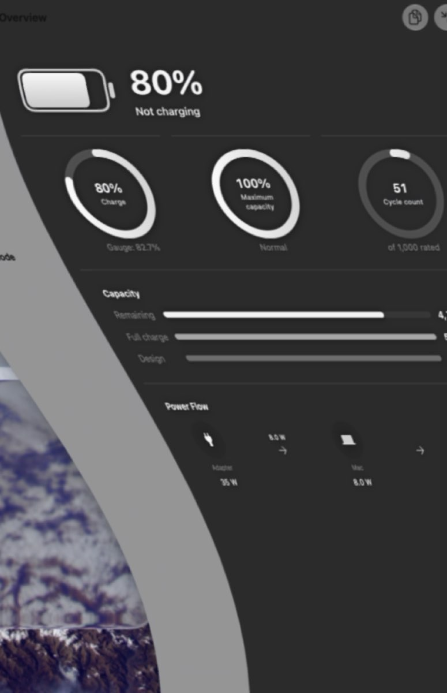
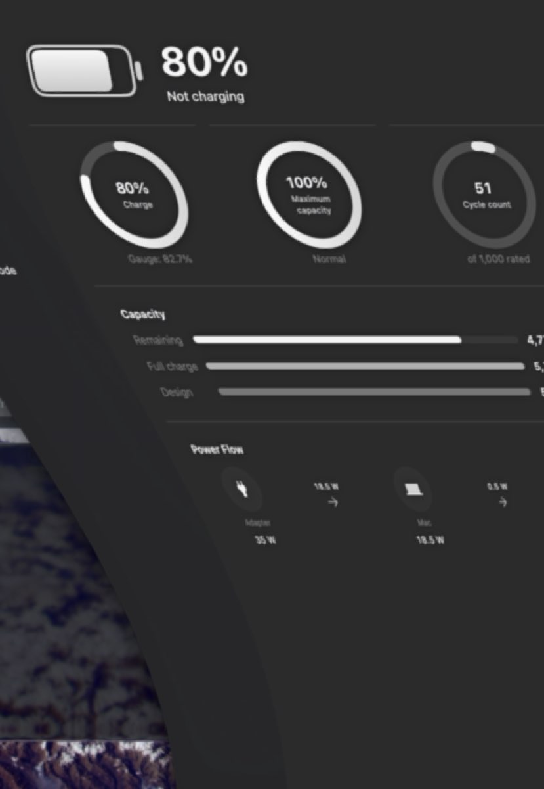
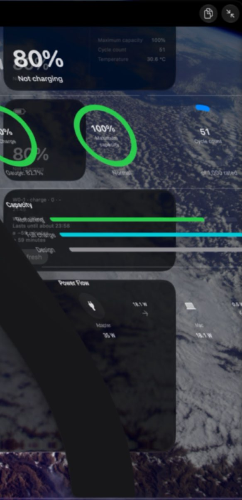
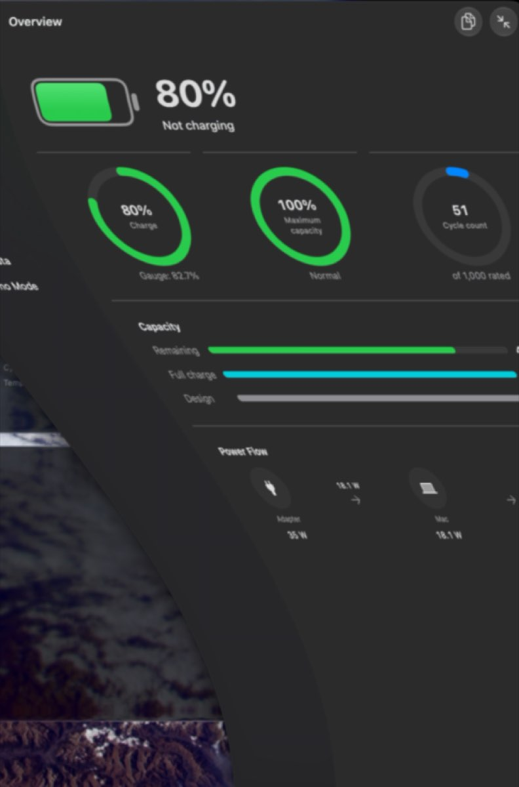

# Session A results (BatteryPulse 0.6.2)

Written by `docs/plans/0.6.2/m5-session.sh send` on 2026-10-24 11:04 +0300. Answers marked "claude"
were judged by the Claude session from the screenshots, frames and logs named in their step;
"person" ones came from the maintainer. Recordings, traces and captures that name devices stay
on the Mac (`~/bp-062/A`).

## Appendix C rows this session owns

| Fact (PLAN.md Appendix C) | Where in this file |
|---|---|
| W0-1: entity query and button results | SPIKE-W's log lines (`spike query`, `spike perform`); W0-1-test-edit |
| W0-2: SPIKE-C and SPIKE-W placed-widget results; edit sheet in English and Russian | SPIKE-C, SPIKE-I, SPIKE-W (pluginkit); W0-2-* answers |
| W0-3: A, A′, B results (errno and byte count) | SPIKE-W's log lines (`spike feed`) |
| W0-4: accessory count; rendering mode per style and place; redactionReasons; click deliveries; scheme need | SPIKE-W's log lines, per mark |
| W0-5: VoiceOver text; Text size | W0-5-* answers |
| W0-6: the offset format's text and cadence | W0-6-* answers |
| F13: UpdateTime changes against "any" lines | pslog, notifyutil and the ioreg sampler |
| E3b: timeremaining followed by "any" (battery and charging) | pslog, notifyutil and the ioreg sampler |
| E20 field run: traps, crash reports, read threads; memory over 2 hours | E20's field run |
| V-01: "executor" log lines, new crash reports, the answers | V-01; V01-* answers |
| mAh cadence: RemainingCapacity changes per hour | pslog, notifyutil and the ioreg sampler |
| Clear's fill (b) and Translucent Dark's today's fill | Clear's minimize fill; fill-* answers |
| page.switch count and p50 per page (before) | Page switches |
| F5: accessory and device captures (bpulse built or not) | F5 |
| Sleep hygiene: pmset -g assertions per run | Energy (the assertions column) |
| SEC-15 timings; diskutil image attach and eject usage text | Attach timing |
| A/B energy (S1, S2, S2 Low Power Mode, S6, S7) | Energy |

## Answers

| ID | Question | Answer | By | Time | Note |
|---|---|---|---|---|---|
| prep-widget-style | System Settings → Appearance → Icon & widget style: which is selected now (Default, Dark, Clear or Tinted)? | Default | person | 20:39 |  |
| prep-dim-widgets | System Settings → Desktop & Dock → Dim widgets on desktop: which value is set now? | Automatically | person | 20:39 |  |
| prep-open-at-login | BatteryPulse Settings → General → Open at login: 1 on, 2 off | 1 | person | 20:39 |  |
| prep-widgets | Are a small and a medium BatteryPulse widget on the desktop, with nothing covering them? 1 yes, 2 no | 1 | claude | 20:39 | widgets-ref shows a medium BatteryPulse widget (top row) and a small one (second row), both with values (49 %, Charging), nothing covering them; Terminal on the right half |
| F5-accessories | Accessories in the captures: 1 bpulse lists what pmset lists, 2 pmset lists accessories bpulse doesn't (hidden from apps), 3 neither lists any | 1 | claude | 20:48 | AirPods Pro in three states (out of the case not worn, in the ears, in the case with the lid open): pmset -g accps (text form) listed 2 unnamed accessory sources each time (case 69-70 %, earbuds 99 %, charging in the case) and bpulse --accessories listed 1 headphones entry with the same two parts and levels; no keyboard at hand |
| F5-iphone | The iPhone page in the packaged app: 1 values shown, 2 an error or no values, 3 no iPhone at hand | 1 | claude | 20:48 | an iPad (9th generation, iPadOS 27.0.1) on a cable stood in for the iPhone; f5-iphone-attached shows its page with values: 100 %, charging at 4.0 W, 81 % maximum capacity, 141 cycles, Connected by cable |
| F5-local-network | Did macOS ask whether BatteryPulse may find devices on the local network? 1 yes, 2 no, 3 no iPhone at hand | 2 | person | 20:44 | an iPad on a cable stood in for the iPhone; only its Trust This Computer prompt appeared (allowed), no local network prompt |
| F5-attach-detach | Did the iPhone page follow the cable: values after attaching, and the device shown as disconnected or gone after detaching? | n | claude | 20:48 | f5-iphone-detached (under a minute after unplugging): a banner '<device> didn't answer. Check the cable and try again.' over the 20:45 values, still 'Connected by cable' and 'Charging at 4.0 W'; f5-iphone-detached-later (17 s on): a fresh read after the cable was out (Updated 20:46, On battery, -3.7 W), still 'Connected by cable', and bpulse --devices a minute later listed the iPad over Wi-Fi; the page never showed the device as disconnected or gone |
| W0-2-C | SPIKE-C over 0.6.1, the placed widgets against the reference picture: 1 same, 2 blank or grey, 3 gone, 4 different (note) | 1 | claude | 20:49 | widgets-C (30 s after the install) shows the medium and the small BatteryPulse widget in the same places as widgets-ref, with current values (54 %, Charging, Full at 23:26; the medium one also Maximum capacity 100 %, Cycle count 51, Temperature 31.7 C); nothing blank or grey; pluginkit lists the widget (0.0.0) from /Applications |
| W0-2-I-small | SPIKE-I, the small widget (small and medium placed under 0.6.1, large and extra large added now): 1 same as the reference or right, 2 blank or grey, 3 gone, 4 different (note) | 1 | claude | 20:52 | widgets-I-all: the small widget placed under 0.6.1 is in its place with current values (55 %, Charging, Full at 23:17), nothing blank or grey |
| W0-2-I-medium | SPIKE-I, the medium widget (small and medium placed under 0.6.1, large and extra large added now): 1 same as the reference or right, 2 blank or grey, 3 gone, 4 different (note) | 1 | claude | 20:52 | widgets-I-all: the medium widget placed under 0.6.1 is in its place with current values (55 %, Charging, Full at 23:17; Maximum capacity 100 %, Cycle count 51, Temperature 31.6 C); a second medium widget added under SPIKE-I (third row) renders the same |
| W0-2-I-large | SPIKE-I, the large widget (small and medium placed under 0.6.1, large and extra large added now): 1 same as the reference or right, 2 blank or grey, 3 gone, 4 different (note) | not answered | | | |
| W0-2-I-xlarge | SPIKE-I, the xlarge widget (small and medium placed under 0.6.1, large and extra large added now): 1 same as the reference or right, 2 blank or grey, 3 gone, 4 different (note) | not answered | | | |
| W0-2-W-small | SPIKE-W over SPIKE-I, the small widget: 1 same as under SPIKE-I, 2 blank or grey, 3 gone, 4 different (note) | 1 | claude | 21:46 | W2 (#307, the same code as W) installed over 0.6.1 by install W2 at 21:45:27, the widget extension ended about 20 ms before the swap: chronod refetched (7 to 307) and got 2 descriptors, every reload succeeded at once under the default intent (no CHSErrorDomain 1103); widgets-W2-retest (30 s later) shows the small widget as under 0.6.1 (widgets-B-before-W2-retest): 80 %, Not charging. The first W install over SPIKE-I hit the stale-descriptor race (Notes) |
| W0-2-W-medium | SPIKE-W over SPIKE-I, the medium widget: 1 same as under SPIKE-I, 2 blank or grey, 3 gone, 4 different (note) | 1 | claude | 21:46 | W2 as for the small one: both medium widgets (placed under 0.6.1 and under SPIKE-I) redraw as under 0.6.1 with fresh values (80 %, Not charging, Maximum capacity 100 %, Cycle count 51, Temperature 30.7 C; widgets-W2-retest against widgets-B-before-W2-retest); the top one carried a configuration edited in the sheets (back to Automatic) and reloaded under its own intent, the other two under the default intent |
| W0-2-W-large | SPIKE-W over SPIKE-I, the large widget: 1 same as under SPIKE-I, 2 blank or grey, 3 gone, 4 different (note) | not answered | | | |
| W0-2-W-xlarge | SPIKE-W over SPIKE-I, the xlarge widget: 1 same as under SPIKE-I, 2 blank or grey, 3 gone, 4 different (note) | not answered | | | |
| W0-2-W-edit | Edit Widget on the Battery widget: are Layout, Main value and Time all there (and Details once Layout is Custom)? | y | claude | 21:16 | edit-battery-en (21:13:41): the sheet 'Battery / BatteryPulse', 'Charge, time remaining and battery health.', Layout Automatic, Main value Charge, Time Clock time; edit-battery-en-custom (21:13:47): Layout Custom adds Details with 4 Choose slots (the medium size), so the ParameterSummary's When clause applies |
| W0-1-test-edit | Edit Widget on the Test widget: are Main value, Details and Device all there, the summary reading 'Show <main value>'? | n | claude | 21:16 | edit-test-en (21:13:58): 'Test widget / BatteryPulse', 'Shows the chosen details and device.', Main value Charge, Details (4 Choose slots on medium; the extra-large Test widget's sheet, edit-test-large-en, shows more), Device; but no summary line appears in the sheet (no 'Show Charge' anywhere), as on the Battery sheet |
| W0-6-format-en | Does the Test widget show a time left like '2 hours, 13 minutes' (lines a and b)? 1 yes, 2 with seconds, 3 something else (note) | 1 | claude | 21:20 | test-widget-en and tick-1 (21:17 entry, Full at 23:18): line b '2 hours, 0 minutes', line a '-2 hours, 0 minutes' (a minus sign: an offset to a later date without sign: .never, as the spike's code comment expects); no seconds; the zero minutes field is shown; earlier frames read '2 hours, 10 minutes' and '2 hours, 6 minutes' |
| W0-6-tick | A minute later, did the Test widget's minutes go down by one without a reload? 1 yes, 2 no, 3 it shows seconds | 1 | claude | 21:20 | test-widget-tick-1 and -2, 65 s apart: the entry's time line stayed 21:17 (no reload) while a went from '-2 hours, 0 minutes' to '-1 hour, 59 minutes' and b from '2 hours, 0 minutes' to '1 hour, 59 minutes'; the recording also caught the extra-large Test widget going from 10 to 9 minutes on an unchanged 21:10 entry |
| W0-2-W-ru | With AppleLanguages (ru) in the extension's preferences: 1 the widgets and the edit sheet in Russian, 2 only the widgets, 3 only the edit sheet, 4 neither (recorded as not checked) | 2 | claude | 21:43 | widgets-W-ru (21:38) and test-widget-ru (21:41): the Battery widgets in Russian (the Russian words for Not charging, Maximum capacity, Cycle count and Temperature), the Test widgets too once Refresh redrew them (Lasts until about, and the button); edit-battery-ru (frame 13 of recordings/edit-ru.mov): the Edit sheet stayed in English (Battery, Layout, Main value, Time, Details) |
| W0-6-format-ru | Does the Test widget show a time left like '2 hours, 13 minutes' (lines a and b)? 1 yes, 2 with seconds, 3 something else (note) | 1 | claude | 21:43 | test-widget-ru (21:41, after Refresh; source fixed, since the charge limit had stopped charging): line b reads '2 chasa 12 minut' (Russian for 2 hours 12 minutes, no comma), line a the same with a minus sign; no seconds; a Test widget not yet redrawn under ru kept English text and its live minutes stayed English |
| W0-2-reinstall | After the script reinstalled 0.6.1: 1 every BatteryPulse widget shows, 2 a widget was blank and was removed and added again (note which) | 1 | claude | 21:48 | widgets-061-again (30 s after the 0.6.1 reinstall over W2, the widget extension ended 20 ms before the swap): the small and both medium Battery widgets show 0.6.1's values (80 %, Not charging, Maximum capacity 100 %, Cycle count 51, Temperature 30.6 C), none blank; the two Test widgets (a kind 0.6.1 doesn't have) keep W2's last picture, their minutes still ticking |
| W0-5-voiceover | What did VoiceOver say for the widget, the battery symbol especially (in English; say which language it spoke), or 'not reached'? | Focus on the Test widget: 'In BatteryPulse, widget, 9 items', then 'Three-Quarter-Charged Battery, image'; one step inside: 'In Three-Quarter-Charged Battery, image, content is empty'. Language: English | person | 22:30 | from the maintainer's two phone photos (not in the repo), on 0.6.1 with SPIKE-W's Test widget still placed, showing 'W0-1 · charge · 0 · –', '21:45', 'W0-6 · fixed', 'Lasts until about 23:58', 'a −2 hours, 6 minutes', 'b 2 hours, 6 minutes' and Refresh. VoiceOver walks the widget as 9 separate items, reads the battery symbol by its SF Symbol name (the 75 % bucket, at 80 %) instead of the charge, and announces an empty group. For 0.7: hide decorative symbols from accessibility, give the charge its own label carrying the value, combine each row into one element, keep Refresh its own button |
| W0-5-text-size | With a larger System Settings → Accessibility → Display → Text size, did the widget's text change? 1 yes, 2 no | 2 | claude | 21:59 | text-size-after shows Accessibility > Display > Text size at 17 pt (System Settings on the right) and the widgets pixel-identical to widgets-061-again, taken minutes earlier on the same 0.6.1 build at the usual size: '80%', 'Not charging', the detail rows and the Test widget's lines at the same size and place. text-size-before caught the Claude app's window over the widgets, so widgets-061-again stands in for it |
| V01-notification | Did the test notification arrive, and did clicking its banner bring BatteryPulse forward? | y | person | 22:03 | the test notification arrived; clicking its banner opened BatteryPulse's window |
| V01-notification-front | And again with the BatteryPulse window in front? | y | person | 22:03 | with the main window in front: it arrived again and the banner's click brought BatteryPulse forward |
| V01-menubar | Does the menu bar icon look right on a light and on a dark menu bar? | y | claude | 22:00 | dark menu bar only: in menubar-light the appearance did turn Light (the widgets and windows went light), but this wallpaper is black at the top, so the see-through menu bar stayed dark with white items in both shots; the item (a battery with the plug glyph and '80%') renders crisp and aligned in both; a light menu bar was not seen |
| V01-pages | Raw Data, History, Demo Mode on and off, Check Now (an offered update closed without installing) and Clear History: did each work? | y | person | 22:03 | Raw Data, History, Demo Mode on and off, Check Now (no update installed) and Clear History all worked |
| V01-lid | After the lid was closed for a minute and opened: does BatteryPulse still run with a current value in the menu bar? | y | claude | 22:06 | after-lid (22:05:38, 10 s after the lid wake at 22:05:28; the Mac slept from about 22:03, with a dark wake and maintenance sleep at 22:03:49-22:04:01): SPIKE-A2 still running (v01 check), its menu bar item shows the current charge, 80 % with the plug glyph, as pmset reads it (80 %, AC attached, not charging); 0 executor lines and 0 crash reports since prepare |
| fill-clear-light | clear-light: while the window shrank into the Dock and came back: 1 like the window, or an even graphite grey, 2 a black frame, 3 something else (note) | 1 | claude | 22:12 | normal-speed animations (Shift-click gives no slow motion on macOS 27.0.1), so the clips were also dumped at 0.05 s (recordings/clear-light-minimize-fine): minimize frames 41-44 (2.05-2.20 s) and a restore within the same clip, frames 92-98 (4.60-4.90 s), show the window's content on an even graphite grey, the sidebar's part lighter grey, no black; dark pixels fall from 16.9 % with the window open (Clear's window is dark) to about 3 %, like the bare desktop; the restore clip caught a second minimize (frame 16 at 3.2 s), the same graphite |
| fill-clear-dark | clear-dark: while the window shrank into the Dock and came back: 1 like the window, or an even graphite grey, 2 a black frame, 3 something else (note) | 1 | claude | 22:58 | two takes, 0.05 s dumps. Take 2 (recordings/clear-dark-*-fine): minimize at 1.10 s (frames 22-25), restore at 2.15-2.45 s (frames 43-49): the shape shows the window's content on an even graphite fill, measured RGB 49,49,49 (luma 0.19, fill b), while the open Clear Dark window itself reads RGB 6,6,10 (frame 50; dark by design); no black frame, border or band. Take 1 (recordings/clear-dark-*-take1-*) caught two minimizes, the same fill (RGB 49,49,49 and 44,44,46), its restore unrecorded |
| fill-translucent-dark | translucent-dark: while the window shrank into the Dock and came back: 1 like the window, or an even graphite grey, 2 a black frame, 3 something else (note) | 2 | claude | 23:02 | today's fill, 0.05 s dumps: minimize at 1.95-2.30 s (frames 39-46) and restore at 1.80-1.95 s (frames 36-39) both show a black band the window doesn't have: the title bar region reads RGB 0,0,0 through the minimize and 6,6,6 through the restore, where the open window reads RGB 11,28,58 (dark blue glass, frame 45 of the restore); the warped edge is a neutral near-black band (RGB 24-36, luma 0.09-0.15) against the window's bluish sidebar (36,39,49); dark pixels rise from 11.3 % with the window open to 19.2 % during the animation |
| fill-translucent-dark-b | translucent-dark with fill (b) extended to it (only after a 2 above): 1 like the window, or an even graphite grey, 2 a black frame, 3 something else (note) | 1 | claude | 23:15 | fill (b) extended to Translucent Dark (b-and-translucent-dark), 0.05 s dumps: minimize at 1.60-1.85 s (frames 32-37) and restore at 1.80-2.00 s: the shape is an even graphite with the window's content; the title bar region reads RGB 49,49,49 through the minimize and 57,57,57 through the restore (today's fill: 0,0,0 and 6,6,6), the lower part 49,49,49; dark pixels fall from 11.3 % to 3-6 % instead of rising to 19 %; no black frame or band |
| energy-setup | Energy setup for the window: display brightness about half, auto-brightness and True Tone off, other apps quit (Terminal and this session stay), a Focus on: 1 done, 2 not all (note) | 1 | person | 23:56 |  |

## Prepare

- prepared: 2026-10-23 20:36:25; macOS 27.0.1 (26A434); script at 56702f9
- installed before the session: 0.6.1 (7)
- defaults domain: 29 keys backed up
- Application Support: 10 files, 252 KB backed up
- appearance: dark mode true, automatic 1; wallpapers: 1
- Low Power Mode: battery 0, adapter 0
- widget extension's AppleLanguages: none
- charge: 80 %, on the adapter; cycle count 51
- kern.pervasive_energy: 1
- bpulse: built

| Build | Version | CFBundleVersion | Source |
|---|---|---|---|
| C | 0.0.0 | 277 | run 39800982102, artifact BatteryPulse-76223738b61a8fc2a442115eb7fc93dba332eb73 |
| I | 0.0.0 | 278 | run 39801168615, artifact BatteryPulse-dbf4dfa11a2fe4a87a38f2f74c44eaeb7a7fabd3 |
| W | 0.0.0 | 282 | run 39806441696, artifact BatteryPulse-a60948765b7e7df33e3a8a5d43a71953d889b411 |
| A2 | 0.0.0 | 285 | run 39808734092, artifact BatteryPulse-cee5033bae2f9e459332a5b22fa971aff2583765 |
| A2P | 0.0.0 | 285 | run 39808734092, artifact BatteryPulse-profiling-cee5033bae2f9e459332a5b22fa971aff2583765 |
| A | 0.0.0 | 158 | run 39413159534, artifact BatteryPulse-076873d5bf151db628de91e216a8bfabb9356e1a |
| B | 0.6.1 | 7 | release v0.6.1 |
| W2 | 0.0.0 | 307 | run 40002896511, artifact BatteryPulse-a60948765b7e7df33e3a8a5d43a71953d889b411 |

## Reference widgets (0.6.1)

- installed: 0.6.1 (7)
- pluginkit:
```
     io.github.nikitausov.BatteryPulse.Widget(0.6.1)	44FEBC1F-F7BC-414B-BCF2-14147E7CD5B2	2026-10-22 13:33:52 +0000	/Applications/BatteryPulse.app/Contents/PlugIns/BatteryPulseWidget.appex
 (1 plug-in)
```

## F5, accessories and devices (0.6.1)

- app: 0.6.1 (7), reading iPhones and iPads on
- bpulse: built

| State | pmset -g accps sources | bpulse --accessories (JSON entries) |
|---|---|---|
| earbuds-out-not-worn | not a list | 1 |
| earbuds-out | not a list | 1 |
| earbuds-in-case | not a list | 1 |

- device log lines since f5 start: 3 (names, serials and UDIDs read back as <private>)
```
20:41:43.376 BatteryPulse MobileDevice 1860.2.5.100.2 loaded
20:47:23.990 bpulse MobileDevice 1860.2.5.100.2 loaded
  
```
- library validation messages naming BatteryPulse: 2

## SPIKE-C over 0.6.1 (W0-2's control)

- before: 0.6.1 (7)
```
     io.github.nikitausov.BatteryPulse.Widget(0.6.1)	44FEBC1F-F7BC-414B-BCF2-14147E7CD5B2	2026-10-22 13:33:52 +0000	/Applications/BatteryPulse.app/Contents/PlugIns/BatteryPulseWidget.appex
 (1 plug-in)
```
- after: 0.0.0 (277)
```
     io.github.nikitausov.BatteryPulse.Widget(0.0.0)	DEFF2AD8-B1F8-4719-8439-C6FA0EE1F8B3	2026-10-23 17:48:33 +0000	/Applications/BatteryPulse.app/Contents/PlugIns/BatteryPulseWidget.appex
 (1 plug-in)
```
- the widget runs from /Applications

## SPIKE-I over SPIKE-C (-internalize-at-link)

- before: 0.0.0 (277)
```
     io.github.nikitausov.BatteryPulse.Widget(0.0.0)	DEFF2AD8-B1F8-4719-8439-C6FA0EE1F8B3	2026-10-23 17:48:33 +0000	/Applications/BatteryPulse.app/Contents/PlugIns/BatteryPulseWidget.appex
 (1 plug-in)
```
- after: 0.0.0 (278)
```
     io.github.nikitausov.BatteryPulse.Widget(0.0.0)	47CAC0F3-2DF7-4336-94C5-87B37DA6FF56	2026-10-23 17:49:47 +0000	/Applications/BatteryPulse.app/Contents/PlugIns/BatteryPulseWidget.appex
 (1 plug-in)
```
- the widget runs from /Applications

## SPIKE-W over SPIKE-I (the configurable kind, the Test kind, the feed, the click logger)

- before: 0.6.1 (7)
```
     io.github.nikitausov.BatteryPulse.Widget(0.6.1)	7C9A4204-6C22-41EF-AE31-C30AC4321F2C	2026-10-23 18:05:08 +0000	/Applications/BatteryPulse.app/Contents/PlugIns/BatteryPulseWidget.appex
 (1 plug-in)
```
- after: 0.0.0 (282)
```
     io.github.nikitausov.BatteryPulse.Widget(0.0.0)	497ED632-D877-48C2-94A5-FD473D5C81E4	2026-10-23 18:06:11 +0000	/Applications/BatteryPulse.app/Contents/PlugIns/BatteryPulseWidget.appex
 (1 plug-in)
```
- the widget runs from /Applications

- expected in Edit Widget: Battery: Layout, Main value, Time (Details once Layout is Custom); Test widget: Main value, Details, Device (summary 'Show <main value>')

## SPIKE-W in Russian (the extension's AppleLanguages)

- AppleLanguages (ru) written to the extension's container preferences; the extension ended

## SPIKE-W's log lines (W0-1, W0-3, W0-4)

- spike lines since SPIKE-W was installed: 87 (static text, numbers and case names only)
```
### before any mark
    1  BatteryPulseWidget spike perform refresh process=widgetExtension pid=N
    6  BatteryPulseWidget spike timeline family=medium main=charge details=0 device=none process=widgetExtension
    2  BatteryPulse spike feed write candidate=A ok bytes=55 sequence=N
    5  BatteryPulseWidget spike timeline family=extraLarge main=charge details=0 device=none process=widgetExtension
    7  BatteryPulseWidget spike feed candidate=A feed ok bytes=55 age=Ns sequence=N version=1
    7  BatteryPulseWidget spike feed candidate=Aprime feed ok bytes=55 age=Ns sequence=N version=1
    2  BatteryPulse spike feed write candidate=Aprime ok bytes=55 sequence=N
    7  BatteryPulseWidget spike accessories sources=2 accessories=1
### desktop-Dark
    3  BatteryPulseWidget spike feed candidate=A feed ok bytes=55 age=Ns sequence=N version=1
    3  BatteryPulseWidget spike accessories sources=2 accessories=1
    1  BatteryPulse spike feed write candidate=A ok bytes=55 sequence=N
    3  BatteryPulseWidget spike feed candidate=Aprime feed ok bytes=55 age=Ns sequence=N version=1
    1  BatteryPulse spike feed write candidate=Aprime ok bytes=55 sequence=N
### aborted-nc-Tinted
    3  BatteryPulseWidget spike timeline family=small main=charge details=0 device=none process=widgetExtension
    2  BatteryPulseWidget spike timeline family=medium main=charge details=0 device=none process=widgetExtension
    1  BatteryPulseWidget spike timeline family=extraLarge main=charge details=0 device=none process=widgetExtension
### nc-Clear
    2  BatteryPulseWidget spike timeline family=medium main=charge details=0 device=none process=widgetExtension
    2  BatteryPulseWidget spike timeline family=small main=charge details=0 device=none process=widgetExtension
### click-closed
    1  BatteryPulse spike click url scheme=batterypulse page=overview windows=1 active=true
### click-open
    5  BatteryPulseWidget spike accessories sources=2 accessories=1
    2  BatteryPulseWidget spike timeline family=extraLarge main=charge details=0 device=none process=widgetExtension
    5  BatteryPulseWidget spike feed candidate=A feed ok bytes=55 age=Ns sequence=N version=1
    2  BatteryPulse spike click activity type=other keys=WGWidgetUserInfoKeyFamily,WGWidgetUserInfoKeyKind webpageURL=false windows=0 active=true
    2  BatteryPulseWidget spike perform refresh process=widgetExtension pid=N
    2  BatteryPulseWidget spike timeline family=medium main=charge details=0 device=none process=widgetExtension
    2  BatteryPulse spike feed write candidate=A ok bytes=55 sequence=N
    5  BatteryPulseWidget spike feed candidate=Aprime feed ok bytes=55 age=Ns sequence=N version=1
    2  BatteryPulse spike feed write candidate=Aprime ok bytes=55 sequence=N
    1  BatteryPulse spike click url scheme=batterypulse page=overview windows=1 active=true
```
- an unknown click activity type, as the spike app stored it: SpikeWidgetIntent

## VoiceOver and Text size on 0.6.1 (W0-5)

- reinstalled: 0.6.1 (7)

## V-01 on SPIKE-A2 (WP-10, WP-14a)

- installed: 0.0.0 (285) at 2026-10-23 21:59:23
- "executor" log lines: 0 since prepare, 0 since SPIKE-A2 was installed
- crash reports since prepare:
- new crash reports: 0 (copies in logs/crash/)
- running now: yes, 0.0.0 (285)

## Clear's minimize fill on SPIKE-A2 (WP-13, Q-B2)

- clear-light, minimize: 6 s, 25178 KB (kept on the Mac); 30 frames at 0.2 s; darkest: frame 29 at 5.800 s, 17.0 % dark pixels
- clear-light, restore: 6 s, 16319 KB (kept on the Mac); 30 frames at 0.2 s; darkest: frame 9 at 1.800 s, 17.0 % dark pixels
- clear-dark, minimize: 6 s, 11036 KB (kept on the Mac); 30 frames at 0.2 s; darkest: frame 7 at 1.400 s, 26.7 % dark pixels
- clear-dark, restore: 6 s, 15019 KB (kept on the Mac); 31 frames at 0.2 s; darkest: frame 9 at 1.800 s, 26.6 % dark pixels
- clear-dark, minimize: 6 s, 11664 KB (kept on the Mac); 30 frames at 0.2 s; darkest: frame 0 at 0.000 s, 24.9 % dark pixels
- clear-dark, restore: 6 s, 12726 KB (kept on the Mac); 30 frames at 0.2 s; darkest: frame 29 at 5.767 s, 24.8 % dark pixels
- translucent-dark, minimize: 6 s, 13689 KB (kept on the Mac); 30 frames at 0.2 s; darkest: frame 10 at 2.000 s, 18.7 % dark pixels
- translucent-dark, restore: 6 s, 16904 KB (kept on the Mac); 30 frames at 0.2 s; darkest: frame 9 at 1.800 s, 15.7 % dark pixels
- translucent-dark-b, minimize: 6 s, 25269 KB (kept on the Mac); 30 frames at 0.2 s; darkest: frame 0 at 0.000 s, 11.4 % dark pixels
- translucent-dark-b, restore: 6 s, 18939 KB (kept on the Mac); 30 frames at 0.2 s; darkest: frame 29 at 5.717 s, 11.4 % dark pixels

## Attach timing on the real 0.6.1 DMG (SEC-15, WP-16)

- verification skip in diskutil's usage: none found

| Variant | Runs (ms) | Median ms |
|---|---|---|
| hdiutil | 158, 139, 154, 152, 149 | 152 |
| hdiutil-noverify | 158, 158, 163, 157, 165 | 158 |
| diskutil | 325, 290, 284, 298, 292 | 292 |
| diskutil-skip | no option, no option, no option, no option, no option | - |

- attaches left over: 0
- diskutil image attach usage:
```
OVERVIEW: Attach a disk image as a device. Will return information about the
attached image upon success.

Upon success will return the /dev node, tab, content hint (if applicable),
another tab, and a mount point (if any filesystems were mounted).

Supports 'ram://<size>', file paths, http[s].
In case of a file path, assumed to be an existing file representing a disk
image.
In case of a ram scheme, can be either ram://<sector count> where sector size
is 512 bytes, or ram://<size> where size is based on size in diskutil(8).
RAM disks cannot be mounted as they do not have the appropriate file system
during their creation.
In case of an http[s] image, the image should exist and be reachable.

By default, will attempt to mount the disk image after attaching (unless it is
a ram disk). In case of no mountable filesystem on the image, the operation
will fail ('mountPolicy=forceMount').
This behaviour is controlled by 'mountPolicy' flag.

USAGE: diskutil image attach [--verbose] [--stdinpassphrase] [--plist] [--readOnly] [--nobrowse] [--mountPoint <mountPoint>] [--mountOptions <mountOptions>] [--mp <mp>] [--noMount] <image-url> [--shadow <shadow> ...]

ARGUMENTS:
  <image-url>             The disk image URL to attach

OPTIONS:
  -v, --verbose           Verbose output
  --stdinpassphrase, --stdinpass
                          Provide the passphrase for the disk image via stdin
  --plist                 Produce output in a plist format
  -r, --readOnly          Force the resulting device to be read-only.
  -b, --nobrowse          Render any volumes invisible in applications such as
                          the macOS Finder.
  --mountPoint <mountPoint>
                          If --mountPoint is specified, then your path, rather
                          than the standard path of /Volumes/VolumeName or
                          /System/Volumes/VolumeName, will be used as the view
                          into the volume file content. If the directory at
                          that path does not exist (but its parent directory
                          does), it will be created automatically and will be
                          deleted when the volume is unmounted. Note that this
                          option works only if the disk image has a single
                          mountable entity (no multiple partitions / volumes).
  --mountOptions <mountOptions>
                          An optional list of mount options to be used during
                          the mount operation separated by ','. See mount(8).
  --mp, --mountPolicy <mp>
                          Mount policy defining how to mount the disk image
                          after attaching. 'noMount' skips mount entirely.
                          'forceMount' will always attempt to mount and fail
                          the operation upon failure. 'autoMount' will attempt
                          to mount the the disk image automatically. In case no
                          mountable file system is found, will skip the mount
                          and attach only. (default: noMount for ram disks,
                          forceMount otherwise)
  -n, --noMount           Same as --mountPolicy=noMount
  --shadow <shadow>       Use a list of shadow files
                          If shadow-path is not specified, <image-path>_shadow
                          will be used
                          Last <shadow-path> will be used as the active shadow
                          file
                          The rest of the shadows must exist
  -h, --help              Show help information.

```
- diskutil eject usage:

## Page switches on SPIKE-A2 (WP-17's before)

- 0.0.0 (285), 10 rounds of 7 pages, a page every 3 s
- page.switch lines per page: overview 5, power 5, history 5, health 5, accessories 5, developer 5, demo 5
```
intervals (ms)
name            trigger      count  p50     p95
page.switch     accessories  5      21.597  24.113
page.switch     demo         5      53.986  56.147
page.switch     developer    5      29.049  41.548
page.switch     health       5      42.433  42.863
page.switch     history      5      29.628  59.410
page.switch     overview     5      29.343  30.231
page.switch     power        5      43.438  56.340
name  trigger  count
```

## Page switches under xctrace (SPIKE-A2's profiling build)

- template: SwiftUI; trace: 1.7G (kept on the Mac)
- page.switch lines per page under the profiler: overview 9, power 10, history 10, health 10, accessories 10, developer 10, demo 10
```
intervals (ms)
name            trigger      count  p50     p95
page.switch     accessories  10     10.052  16.302
page.switch     demo         10     36.853  48.794
page.switch     developer    10     14.165  22.947
page.switch     health       10     36.504  41.619
page.switch     history      10     18.467  27.987
page.switch     overview     9      22.322  23.643
page.switch     power        10     41.019  52.637
name           trigger  count
```
- the trace's tables: dyld-library-load hang-risks hitches-frame-lifetimes hitches-framewait hitches-gpu hitches-renders hitches-updates hitches kdebug-strings kdebug life-cycle-period os-log potential-hangs process-info runloop-events swiftui-causes swiftui-changes swiftui-full-causes swiftui-layout-updates swiftui-update-groups swiftui-updates SwiftUIFilteredUpdates SwiftUILayoutUpdates2 thread-info tick time-profile time-sample 

## Energy, A against B (WP-21)

- on battery; each run: the build installed, 1 minute to settle, then rusage over 4 minutes (S6: 10, displays asleep)
- A: 0.0.0 (158), B: 0.6.1 (7); started 2026-10-23 23:56:41 at 83 %; ended 2026-10-24 01:00:32 at 77 %

| Run | Build | Power | Low Power Mode | Energy mJ/h | Idle wake-ups/h | Interrupt wake-ups/h | CPU s/h | Footprint MB | App reads/min | BatteryPulse assertions |
|---|---|---|---|---|---|---|---|---|---|---|
| S1 | B | battery | 0 | 229.3 | 945 | 1890 | 1.779 | 20.3 | 2.0 | 0 |
| S1 | A | battery | 0 | 166.1 | 900 | 1440 | 1.367 | 19.9 | 3.0 | 0 |
| S2 | B | battery | 0 | 443.5 | 1290 | 2490 | 4.664 | 20.4 | 6.0 | 0 |
| S2 | A | battery | 0 | 504.4 | 1575 | 2730 | 5.090 | 20.1 | 8.0 | 0 |
| S2 | B | battery | 0 | 517.2 | 1440 | 2700 | 4.778 | 20.6 | 6.2 | 0 |
| S2 | A | battery | 0 | 948.4 | 1530 | 3495 | 5.942 | 20.0 | 8.0 | 0 |
| S2-LPM | B | battery | 1 | 258.3 | 1065 | 1860 | 2.362 | 21.3 | 3.5 | 0 |
| S2-LPM | A | battery | 1 | 478.5 | 1530 | 2265 | 4.862 | 21.1 | 8.5 | 0 |
| S6 | B | battery | 0 | 215.0 | 1020 | 1770 | 2.021 | 20.4 | 2.1 | 0 |
| S6 | A | battery | 0 | 166.0 | 594 | 1422 | 1.485 | 20.1 | 3.2 | 0 |

## S7, cold launches to menuBarReady (A against B)

### S7 B
- launch 1: 162 ms from open to menuBarReady
- launch 2: 160 ms from open to menuBarReady
- launch 3: 161 ms from open to menuBarReady
- launch 4: 139 ms from open to menuBarReady
- launch 5: 141 ms from open to menuBarReady
```
processes
pid    image               reads  reads before menuBarReady  widget reloads  reads per notify burst
35071  BatteryPulseWidget  3      -                          0               -
35087  BatteryPulse        1      1                          0               -
35121  BatteryPulse        1      1                          0               -
35141  BatteryPulse        1      1                          0               -
35159  BatteryPulse        1      1                          0               -
35191  BatteryPulse        1      1                          0               -
```
### S7 A
- launch 1: 179 ms from open to menuBarReady
- launch 2: 174 ms from open to menuBarReady
- launch 3: 177 ms from open to menuBarReady
- launch 4: 155 ms from open to menuBarReady
- launch 5: 151 ms from open to menuBarReady
```
processes
pid    image               reads  reads before menuBarReady  widget reloads  reads per notify burst
35407  BatteryPulseWidget  3      -                          0               -
35417  BatteryPulse        3      2                          0               -
35451  BatteryPulse        3      2                          0               -
35472  BatteryPulse        3      2                          0               -
35493  BatteryPulse        3      2                          0               -
35528  BatteryPulse        3      2                          0               -
```

## E20's field run on SPIKE-A2

- start: 2026-10-24 01:01:05, 0.0.0 (285), power in the menu bar, the display kept on
- phys_footprint at the start: 20.2 MB
- the adapter: plugged in at 2026-10-24 01:56:51
- end: 2026-10-24 02:56:36; the same process: yes
- phys_footprint at the end: 20.5 MB
- reads by thread (the main thread is the one menuBarReady was logged on):
```
process 43393: 0 reads on the main thread, 0 off it, 1 before its main thread was known
process 38130: 1 reads on the main thread, 711 off it, 0 before its main thread was known
```
```
intervals (ms)
name            trigger   count  p50    p95
accessory.read  -         1      0.481  0.481
adapter         -         746    0.490  0.664
children        -         746    1.071  1.130
history.record  -         670    0.141  1.049
iops            -         746    0.393  0.446
parse           -         746    0.198  0.224
read            -         746    7.232  9.716
refresh         followUp  5      7.738  8.115
refresh         launch    1      8.019  8.019
refresh         notify    122    7.592  9.884
refresh         poll      584    7.664  10.108
registry        -         746    5.290  5.729
smc.other       -         103    2.124  2.627
smc.power       -         668    0.478  0.976

events
name           trigger  count
menuBarReady   -        1
widget.reload  policy   8
widget.reload  update   1

processes
pid    image               reads  reads before menuBarReady  widget reloads  reads per notify burst
38124  BatteryPulseWidget  3      -                          0               -
38130  BatteryPulse        712    1                          9               1 1 1 1 1 1 1 1 1 1 1 1 1 1 1 1 1 1 1 1 1 1 1 1 1 1 1 1 1 1 1 1 1 1 1 1 1 1 1 1 1 1 1 1 1 1 1 1 1 1 1 1 1 1 1 1 1 1 2 1 1 1 1 1 1 1 1 1 1 1 1 1 1 1 1 1 1 1 1 1 1 1 1 1 1 1 1 1 1 1 1 1 1 1 1 1 1 1 1 1 1 1 1 1 1 1 1 1 1 1 1 1 1 1 1 1 1 1 1 1 1
38137  BatteryPulseWidget  30     -                          0               -
43393  bpulse              1      -                          0               -
```
- "executor" log lines during the window: 0
- crash reports during the window:
- new crash reports: 0 (copies in logs/crash/)

## pslog, notifyutil and the ioreg sampler (F13, E3b, mAh cadence)

- lines read: notify.txt (notify.txt: 361 lines, pslog.txt: 659), each stamped through a pseudo-terminal when it was written
- samples: 1072; adapter: plugged in at 2026-10-24 01:56:51
- lines by notification key ("other" is pmset's own text):
```
any 194
percent 20
source 1
timeremaining 146
```
```
battery: 2.00 h sampled; UpdateTime changes 126, with an "any" line since the sample before 126 (F13)
battery: timeremaining lines 125; an "any" within 10 ms after 125, within 10 ms either side 125 (E3b)
battery: RemainingCapacity changes 122, 60.9 an hour
charging: 0.99 h sampled; UpdateTime changes 62, with an "any" line since the sample before 62 (F13)
charging: timeremaining lines 21; an "any" within 10 ms after 21, within 10 ms either side 21 (E3b)
charging: RemainingCapacity changes 21, 21.1 an hour
```
- the first lines of each, to show what they name:
```
1792789043.0440349579 com.apple.system.powersources
1792789085.3802769184 com.apple.system.powersources.timeremaining
1792789085.3803889751 com.apple.system.powersources
1792789086.2139339447 com.apple.system.powersources
1792789146.0453550816 com.apple.system.powersources.timeremaining
1792788996.7105329037 Logging IORegisterForSystemPower sleep/wake messages
1792788996.7106060982 pmset is in logging mode now. Hit ctrl-c to exit.
1792788996.7111179829 2026-10-23 23:56:36 +0300 IOPSNotificationCreateRunLoopSource
1792788996.7113339901 Now drawing from 'Battery Power'
1792788996.7114748955  -InternalBattery-0 (id=23330915)	83%; discharging; (no estimate) present: true
1792789043.0445449352 2026-10-23 23:57:23 +0300 com.apple.system.powersources
1792789085.3804960251 2026-10-23 23:58:05 +0300 com.apple.system.powersources.timeremaining
1792789085.3805630207 2026-10-23 23:58:05 +0300 com.apple.system.powersources
```
- results ready in ~/bp-062/A/A.md; not sent yet (send runs after the maintainer has seen them)

## Restore

- restored 2026-10-24 02:56:43: 0.6.1 (7), the settings domain, Application Support, the widget's data and preferences, Low Power Mode, the wallpaper and the appearance

## Notes

- 20:48: F5: no keyboard at hand, so keyboard-bluetooth and keyboard-cable were skipped; the AirPods were captured out of the case but not worn (earbuds-out-not-worn), then in the ears (earbuds-out), then in the case with the lid open (earbuds-in-case).
- 20:48: F5: pmset -g accps -xml writes one plist document per power source, back to back (3 in every state here: the internal battery, then the two AirPods sources), so plutil reads only the first, the internal battery's dictionary, and the table's pmset column reads 'not a list'. The session also saved pmset -g accps's text form per state (logs/f5-<state>-pmset.txt): 2 accessory lines in each AirPods state, with the name left empty.
- 20:48: Script quirk: log_since counts the ndjson summary line ({"count":N,"finished":1}) that log show prints after every query, even an empty one ({"count":0,...}), so every count is one too high and "none" reads 1. F5's 3 device lines are 2 ('MobileDevice 1860.2.5.100.2 loaded', in BatteryPulse and in bpulse; 0.6.1 logs no device reads), and its 2 library validation messages are 1: log's own 'log run noninteractively' line, which quotes the predicate. No library validation message names BatteryPulse.
- 20:52: W0-2-I-large and W0-2-I-xlarge not answered: SPIKE-I's widget, like 0.6.1's, declares only .systemSmall and .systemMedium (BatteryPulseWidget.swift:25), so the widget gallery offers no large or extra-large BatteryPulse widget. The maintainer added a second medium widget instead (widgets-I-all, third row); it renders like the first.
- 20:58: SPIKE-W install, first attempt (the UpdateInstaller way: swap, lsregister -f, relaunch; CFBundleVersion 278 to 282): chronod did notice it (20:52:19.590 'Refetching descriptors due to extension version change, from 278-278 to 282-282'), but its descriptor query (20:52:19.619-.621, 2 ms) was answered before SPIKE-W's extension process started (20:52:20), evidently by SPIKE-I's extension, still running: 1 widget descriptor (kind battery, systemSmall and systemMedium, hasDefaultIntent NO), while SPIKE-W declares 2 kinds (Battery as an AppIntentConfiguration, and the Test widget). chronod stored that as version 282's. Result: the placed widgets' context menu had no Edit item, the gallery offered only Battery (small, medium) with a preview from before the session (39 %), no Test widget, and every timeline reload failed with CHSErrorDomain 1103 'Intent configuration is required but was not provided' (both placed families), so SPIKE-W's widget never rendered or read the feed (the app wrote it and asked for reloads at 20:52:20 and 20:52:27). A chronod restart (killall chronod, 20:59) found the extension 'Unchanged' (282) and kept those descriptors; it dropped the cached snapshots (bundleStubNotSupported: 'Bundle version did not match; LaunchServices DB may need to be rebuilt'), and the three placed BatteryPulse widgets turned to grey placeholders (widgets-W-after-chronod).
- 21:08: SPIKE-W install, second attempt (21:06, after install B, with the app quit and the widget extension ended first): chronod refetched (7 to 282) and got 2 widget descriptors in 113 ms from a freshly started extension; two reloads failed at once (CHSErrorDomain 1050, 21:06:12), then every reload succeeded under the default intent (from 21:06:13), the widget read the feed (A and Aprime, 55 bytes) and the accessories (sources=2 accessories=1), and the three placed widgets redrew in today's look with fresh values (widgets-W2). So a widget placed by 0.6.1 survives its kind becoming an AppIntentConfiguration, with the Automatic layout, when the descriptor fetch reaches the new extension.
- 21:08: The reverse race too: install B over SPIKE-W (21:05:08) got 2 descriptors (battery and spike) from SPIKE-W's still-running extension and stored them as version 7's; chronod's scheduled maintenance ('Reloading descriptors with unresolved default intents', 21:05:31) fetched again, got 0.6.1's 1 descriptor, and the widgets came back (widgets-B-before-W2). A cached descriptor without intents (the SPIKE-W case) never qualifies for that refetch, so it stays wrong until the next version change. For 0.7's in-app update this suggests ending the old widget extension before the new bundle is registered; whether UpdateInstaller's own order hits the race wasn't tested (the script runs lsregister -f before it ends the extension).
- 21:08: W0-2-W-large and W0-2-W-xlarge not answered: SPIKE-W's Battery kind also declares only .systemSmall and .systemMedium; only the Test kind offers large and extra large.
- 21:16: Step 3's edit sheets were shot from a 70 s screen recording (recordings/edit-sheets.mov, frames 7, 13, 24, 31), since the sheets close when the session's window takes focus. The maintainer added a medium and an extra-large Test widget (not a small one; the log names the families medium and extraLarge); both render the W0-1 and W0-6 lines and a Refresh button.
- 21:35: Charge Limit capture (read-only; logs/charge-limit-80 at 21:33 and logs/charge-limit-100 at 21:34, kept on the Mac): the maintainer set System Settings > Battery > Charge Limit to 80 %, then to 100 %; the battery was at 79 % and charging both times, so the limit wasn't reached. No key named ChargeLimit or OptimizedCharging for the Mac's battery, and no value 80, in bpulse --raw, ioreg (AppleSmartBattery, AppleSmartBatteryManager, IOPMPowerSource) or pmset (pmset -g has no charge-limit line; lowpowermode 0). Matches: AppleSmartBattery > ChargerData > NotChargingReason = 0, TimeChargingThermallyLimited = 0 (also SlowChargingReason = 0, IsCharging = 1, PMUConfigured = 2224, PMUConfiguration = 2330), identical at 80 % and 100 %; the child AppleChargerData > ChargerData has the same NotChargingReason and TimeChargingThermallyLimited; AppleSmartBatteryPack > BatteryData > VacVoltageLimit = 4455. pmset -g accps -xml has 'Optimized Battery Charging Engaged' = false only in the two AirPods sources (documents 2 and 3), not the internal battery's. bpulse --smc lists 43 CH* keys (CH0D to CHTC) with types but no values; no SMC value is 80 (only B0FI's raw bytes read 8000); B0UC = 79, SBAS = 78.0.
- 21:37: Charge Limit engaged (read-only capture logs/charge-limit-80-engaged at 21:37, the limit back at 80 %, the battery at 80 %, pmset -g batt: 'AC attached; not charging'): AppleSmartBattery > ChargerData > NotChargingReason = 16777216 (0x01000000; 0 at 21:33) and IsCharging = 0; AppleChargerData > ChargerData > NotChargingReason = 16777216, ChargingCurrent = 0 (2626 at 21:33), ChargingVoltage = 4296 (4314), ChargerInhibitReason = 0, ChargerHwIlimBackoffReason = 16 (16); top level IsCharging = No, ExternalConnected = Yes, ExternalChargeCapable = Yes, FullyCharged = No; pmset accps (internal battery) Is Charging = false, Is Charged = false, Time to Full Charge = 0. SMC: B0AC and B0AP 0 (1954 and 25146 at 21:33), B0UC = 80 and SBAS = 80.0 (the charge); the CH* keys still list no values. The limit's value (80) appears in no key of these sources.
- 21:40: Put back by hand at restore: System Settings > Privacy & Security > Accessibility, turn Terminal off. The maintainer allowed it at 21:30 when the session's osascript query of BatteryPulse's windows (System Events) asked for it; the session doesn't need it.
- 21:43: SPIKE-W's log summary: no 'spike render' line in any segment or process, although the widgets redrew in every style and place (desktop-* and nc-* screenshots), so W0-4 (2) and (3) have screenshots but no rendering mode, container background or redaction data; no 'spike query' line (the Device chooser was never opened). Clicks: the Battery widget's widgetURL reached the app as batterypulse://page/overview both with no window and with the main window open (windows=1 both times); two clicks on the Test widget's body arrived as an NSUserActivity of an unknown type (its raw string, as the spike app stored it: SpikeWidgetIntent) with userInfo keys WGWidgetUserInfoKeyFamily and WGWidgetUserInfoKeyKind, no webpageURL, no window open. Refresh's perform ran in the widget extension (process=widgetExtension), 3 times.
- 21:46: W0-2 retest with W2 (#307, the same code as W, rebuilt for a new CFBundleVersion), on script 56702f9: prepare (21:44) downloaded W2 and reinstalled 0.6.1 (the widget extension ended 0 ms before the swap; chronod got 0.6.1's 1 descriptor), then install W2 (21:45:27; the extension ended about 20 ms before the swap): chronod refetched 7 to 307 and got SPIKE-W's 2 descriptors (21:45:27.670); the only error was one placeholder reload at the swap (NSCocoaErrorDomain 4099, the old process's connection); the battery and spike kinds' reloads all succeeded within 0.5 s. This is the install path 0.6.2's installer is to use; W0-2-W-small and -medium answer from it.
- 21:57: The Charge Limit capture taken while the limit was engaged (bpulse --raw at 21:37; serials, manufacturer data and MfgData read REDACTED; no UDID or device name): [charge-limit-80.plist](A/charge-limit-80.plist)
- 22:15: Step 6: Shift-click gives no slow motion on macOS 27.0.1 (the maintainer and the cloud session found this before), so the minimize and restore ran at normal speed (about 0.3 s) and each clip was also dumped at 0.05 s (recordings/<case>-<phase>-fine). The maintainer restored early in some clips, so a clip labelled restore may hold a second minimize; the answers name the frames. clear-light's fill measured RGB 49,49,49 too.
- 22:16: Attach timing (the real 0.6.1 DMG, 5 runs each after one warm-up): hdiutil attach median 152 ms, with -noverify 158 ms (no gain), diskutil image attach 292 ms; diskutil image attach's usage (macOS 27.0.1) has no verification-skip option (its options: -v, --stdinpassphrase, --plist, -r/--readOnly, -b/--nobrowse, --mountPoint, --mountOptions, --mp/--mountPolicy, -n/--noMount, --shadow, -h), so the diskutil-skip variant didn't run; no failures, no attach left over.
- 22:30: Charge Limit, read-only extras (22:18, on the adapter, limit 80 %, the battery held at 80 %: 'AC attached; not charging'; files in logs/charge-limit-80-battlimit): pmset -g battlimit (no privileges) prints the configured value in two entries, both chargeSocLimitSoc = 80, chargeSocLimitReason = manualChargeLimit, chargeSocLimitDrain = 1, chargeSocLimitIsEOC = 1, chargeSocLimitNoChargeToFull = 0, Terminated = 0 (owner PID left out). /Library/Preferences/com.apple.powerd.charging.plist (root, world-readable): keys bootSessionUUID and policies, the latter an NSKeyedArchiver archive of ChargeCtrlPolicy objects with keys drain, isEndOfCharge, noChargeToFull, owner, reason (manualChargeLimit), soclimit, terminated and token (an NSUUID). defaults read com.apple.batteryui.charging.mac: one key, com.apple.batteryui.charging.mac.prior.limit = 80. notifyutil -g com.apple.system.powersources.chargingtofulloverride = 0. SMC: CHLT hex_ 3 bytes and CHNC hex_ 8 bytes listed, no CHLS key. At the hold (logs/charge-limit-80-engaged): ChargerInhibitReason = 0 and PowerDistribution > IPDChargingAllowed = 0, besides NotChargingReason = 16777216.
- 23:17: Deviations from SESSION.md (the cloud session agreed): killall chronod once (20:59) to diagnose the first W install; install B and spike w again by hand (21:05-21:06, the app quit and the widget extension ended first) before the scripted W2 retest; step 3's edit sheets and the Russian edit sheet shot from the session's own fixed-length screen recordings, since the sheets close when Terminal takes focus; Clear Dark recorded twice (the first take kept as take1); step 7 run before step 6's last cases; the worktree moved 7a9cbd4 to 56702f9 to 1429695 mid-session, each time before an install; Terminal got Accessibility from the session's osascript window query; the maintainer changed the Charge Limit (80, 100, 80 %) for read-only captures. Findings to keep in view: a click on the Test widget's body arrives as an NSUserActivity of type SpikeWidgetIntent (not a URL); the Russian edit sheet stays English while the widgets follow the extension's AppleLanguages.
- 23:24: Page switches (step 8, SPIKE-A2): 5 page.switch lines per page instead of 10: the maintainer clicked along for the first 5 of the 10 rounds (23:18:40-23:21:10, one switch every 4.4 s in the cued order, the first cue finding Overview already selected), then stopped; so the p50 and p95 rest on 5 switches per page.
- 23:48: Charge Limit 80 to 100 to 80 (read-only, on the adapter; files in logs/charge-limit-check-{80-before,100,80-after}; each read 1 minute after the maintainer's change). 80 % (23:44:16): pmset -g batt '80%; AC attached; not charging'; pmset -g battlimit 2 entries, chargeSocLimitSoc = 80, Reason manualChargeLimit, Drain 1, IsEOC 1, NoChargeToFull 0, Terminated 0; powerd charging plist modified 23:42:28, 1 ChargeCtrlPolicy (soclimit 80, reason manualChargeLimit, drain true, isEndOfCharge true, noChargeToFull false, terminated false); com.apple.batteryui.charging.mac prior.limit = 80; bpulse --raw: NotChargingReason 16777216 in AppleSmartBattery > ChargerData and AppleChargerData > ChargerData, IsCharging 0, ChargingCurrent 0, ChargerInhibitReason 0, IPDChargingAllowed 0. 100 % (23:45:50): '83%; charging'; pmset -g battlimit 'No battery level limits set'; the plist rewritten at 23:44:28 with no policy; prior.limit still 80; NotChargingReason 0 in both places (bit 24 clears), IsCharging 1, ChargingCurrent 2626, ChargerInhibitReason 0, IPDChargingAllowed 1. Back to 80 % (23:47:21): '83%; AC attached; not charging'; battlimit and the policy as at 80 % (the plist rewritten at 23:47:18); NotChargingReason 16777216 in both places again, IsCharging 0, ChargingCurrent 0, IPDChargingAllowed 0, and ChargerInhibitReason 268439552 (0x10001000), which was 0 while held at exactly 80 %. The charge moved from 80 % to 83 % during the 100 % minute: the window starts from about 83 %.
- 23:48: W0-5, the widgets' accessibility tree read through System Events (Finder's desktop group holds one AXGroup per desktop widget; 23:49, on SPIKE-A2's profiling build, whose widget is 0.6.1's; roles, descriptions and values only): each BatteryPulse widget is a group described 'widget' with flat children. Medium: an AXImage described 'image' with no label or value (the battery symbol), then 8 AXStaticText values '83%', 'Not charging', 'Maximum capacity', '100%', 'Cycle count', '51', 'Temperature', '37.8 °C': 9 elements, the 9 items VoiceOver counted. Small: the image, '83%', 'Not charging'. The Test widget (SPIKE-W's last picture): 8 AXStaticText ('W0-1 · charge · 0 · -', '21:45', 'W0-6 · fixed', 'Lasts until about 23:58', 'a', '-10 minutes', 'b', '10 minutes') and an AXButton. No element pairs a label with its value, the symbol carries no label, and the time-left lines split the letter from the value.
- 23:52: Page switches under xctrace (step 8, SPIKE-A2's profiling build, SwiftUI template): the session switched the pages itself, selecting the sidebar's rows through System Events (Terminal's Accessibility), in the cued order every 3.4 s, since the maintainer had tired of the drill; a first profiling pass (23:26-23:31) had only about 10 switches inside its trace because the session's driver missed the start, and the rerun (xctrace 23:33:19-23:37:19, 70 switches 23:33:21-23:37:17) replaced it. xctrace then took about 14 minutes to finalize the 1.7 GB trace at full CPU (done about 23:51). Scripted switches read lower than the maintainer's clicks on the non-profiling build (p50 accessories 10 vs 22 ms, history 18 vs 30, developer 14 vs 29, overview 22 vs 29, health 37 vs 42, power 41 vs 43, demo 37 vs 54), so the two sets compare only roughly. The SwiftUI tables are read after the window, so the reading doesn't load the energy runs.
- 23:55: Before the window (23:55): display brightness 50 %, auto-brightness and True Tone off, a Focus (Sleep) on, only Finder and Terminal open as foreground apps; System Settings > Battery: Optimized Battery Charging on, Charge Limit 80 %; the battery at 83 % on the adapter, not charging (above the limit). Put back by hand after the window: auto-brightness and True Tone on.
- 10:30: Charge Limit at window +1:58 (read at 01:54:36, on battery, 72 %, discharging; files in logs/charge-limit-window-1h58): pmset -g battlimit read "No battery level limits set" and the powerd charging plist held no ChargeCtrlPolicy; the plist had last changed at 00:01:28, about 5 minutes into the window on battery. com.apple.batteryui.charging.mac's prior.limit stayed 80.
- 10:30: Charge Limit after plug-in (adapter at 01:56:51, read at 01:56:56; files in logs/charge-limit-check-window-after-plug): the powerd charging plist changed at 01:56:48 and again held one ChargeCtrlPolicy with the values it had before the window (soclimit 80, drain true, isEndOfCharge true, noChargeToFull false, terminated false, reason manualChargeLimit); pmset -g battlimit showed chargeSocLimitSoc = 80 again; prior.limit 80. So powerd keeps the limit's policy only while on AC: it dropped it on battery and restored it at plug-in, and the setting wasn't lost. At the read, bpulse --raw and ioreg showed IsCharging false, NotChargingReason 128 (not bit 24), ChargerInhibitReason 0, ChargingCurrent 0, IPDChargingAllowed 0. That was transient: the gauge's next update (01:57:41, ioreg sampler) was charging (RemainingCapacity 3965 to 3996 mAh, SystemPowerIn about 32.9 W). pslog: 80 %, charging at 02:14:09, then 80 %, AC attached, not charging from 02:15:09 to the end, so the limit held at 80 %. The field run's bpulse process (43393, 1 read) is this read.
- 10:30: S6 B was disturbed: pmset displaysleepnow turned the display off at 00:39:18, and it came back on at 00:39:20 (pmset -g log: "Display is turned on"), the same second S6 B's 10-minute rusage began; the maintainer reports waking the Mac during the window. The display stayed on through the whole S6 B run (00:39:20 to 00:49:20), while S6 A ran with it off (00:50:26 to 01:00:30), so S6 B's row measures the display on and doesn't compare with S6 A's. Session B runs S6 B again beside the RC (PLAN.md). These were the window's only display or sleep events besides the script's own: the field run kept the display on, and the plug-in didn't change it. Claude's checks at the window's start ended at 23:57:03, inside S1 B's settle minute, before its rusage (23:57:44 to 00:01:44).
- 11:03: SwiftUI tables of step 8's trace (SPIKE-A2's profiling build; read after the window): swiftui-updates holds 1.41 M updates of BatteryPulse in 240 s (1,352,615 Other Updates, 55,544 View Body Updates, 412 Representable Updates). Each switch's window runs to the next switch, at most 3.4 s; durations are the instrument's, so sums may include nested updates. Per page: median updates and summed update time per switch, the slowest single updates, the slowest view bodies. overview (9 switches): 5.5 k, 27.8 ms; slowest 1.4-2.7 ms (RootGeometry); bodies OverviewView 0.46 ms, PowerFlowView 0.28 ms. power: 8.9 k, 47.8 ms; RootGeometry 2.9-3.9 ms at +29-39 ms on every switch; bodies Text 1.47 ms, PowerView 0.67 ms, GroupedFormRoot 0.43 ms. history: 29.6 k, 87.3 ms; slowest 1.2 ms (2.4 ms on the first switch); bodies HelpView 1.06 ms, PowerChart 0.61 ms, ChargeChart 0.56 ms. health: 11.6 k, 50.7 ms (161 ms on the first switch); RootGeometry 1.7-2.4 ms; bodies under 0.5 ms. accessories: 7.9 k, 23.0 ms; AccessorySymbol's body 4.35 ms on the first switch only, later switches' slowest 0.3-0.6 ms. developer (Raw Data): 47.3 k, 158.4 ms; on 9 of 10 switches one Action Callback on the main thread took 34.2-38.5 ms, 96-127 ms after the switch began (7.5 ms at +19 ms on the 4th), the trace's slowest updates and outside the page.switch interval (p50 14 ms), then another of 5-7 ms 2.1-2.6 s later; bodies DeveloperView 1.61 ms (18.5 ms summed over 30), Divider 1.37 ms. demo: 28.9 k, 79.2 ms; slowest 1.1-1.3 ms; bodies under 0.25 ms (DemoView 0.20 ms). The per-page summary stays on the Mac (logs/pages-swiftui-summary.txt).

## Images

clear-light: mid-minimize at normal speed (0.05 s frame 42); the window's content on an even graphite fill (fill b), the sidebar's edge lighter grey, no black



clear-dark: mid-minimize at normal speed (0.05 s frame 32); the window's content on an even graphite fill, RGB 49,49,49 (fill b), lighter than the open window's own dark glass, no black



translucent-dark on today's fill: mid-minimize (0.05 s frame 40); a pure black title bar (RGB 0,0,0) and a near-black band along the warped edge, which the open window (dark blue glass, RGB 11,28,58) doesn't have



translucent-dark with fill (b) extended to it: mid-minimize (0.05 s frame 33); an even graphite fill, RGB 49,49,49, title bar included, no black band



